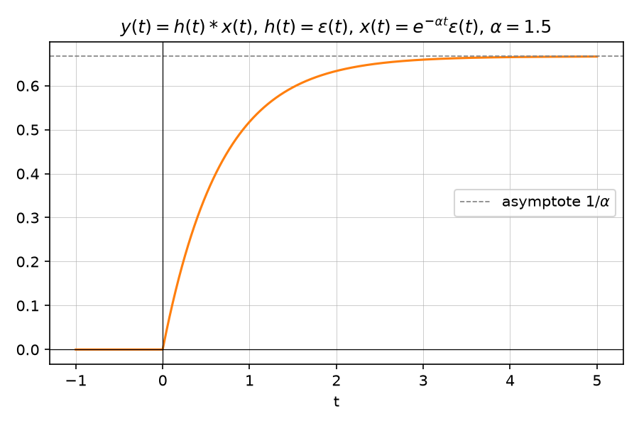

# Convolution

Source: [Lecture 2, pp. 2–3, 9](../../raw/signals_2.pdf). Describes how the
output of an [LTI system](lti-systems.md) relates to its input and impulse
response.

## Definition

$$y(t) = x(t) * h(t) = \int_{-\infty}^{\infty} h(\tau)\,x(t-\tau)\,d\tau$$

## Convolution with the unit step

$$y(t) = x(t) * \varepsilon(t) = \int_{-\infty}^{\infty} x(\tau)\,\varepsilon(t-\tau)\,d\tau = \int_{-\infty}^{t} x(\tau)\,d\tau$$

i.e. convolving with $\varepsilon(t)$ integrates the signal (p. 2).

## Properties

- **Commutativity**: $x(t)*y(t) = y(t)*x(t)$.
- **Distributivity**: $x(t)*[y(t)+z(t)] = x(t)*y(t) + x(t)*z(t)$.
- **Associativity**: $x(t)*[y(t)*z(t)] = [x(t)*y(t)]*z(t)$.
- **Neutral element**: $x(t) * \delta(t) = x(t)$ (p. 2).
- **Shifted Dirac**: $x(t) * \delta(t-t_0) = x(t-t_0)$ (p. 2).

## Cyclic convolution of periodic signals

For two periodic signals $x(t)$, $y(t)$ with the same period $T$, the
integral of their convolution is also periodic ("cyclic convolution"):

$$x(t) \circledast y(t) = \int_{t_0}^{t_0+T} x(\tau)\,y(t-\tau)\,d\tau$$

(p. 2).

## Convolution with a Dirac impulse comb

A periodic signal $x_T(t)$ can be represented as the convolution of one
period $x(t)$ with a [Dirac comb](dirac-impulse.md):

$$x_T(t) = x(t) * \sum_{k=-\infty}^{\infty} \delta(t-kT)$$

(p. 3). This relation reappears in the Fourier-domain in
[Fourier series and Fourier transform](fourier-series.md).

## Relation between correlation and convolution

$$r_{xy}^{E}(\tau) = x^*(-\tau) * y(\tau), \qquad r_{xy}^{E}[k] = x^*[-k] * y[k]$$

$$r_{xy}^{P}(\tau) = \frac{1}{T}\,x(\tau) \circledast y(\tau)$$

A correlation is computed as a convolution with the **reflected** (and, for
complex signals, conjugated) signal (p. 3). See
[Correlation and orthogonality](correlation-and-orthogonality.md).

## Worked examples

*Figure: $y(t)=\varepsilon(t) * e^{-\alpha t}\varepsilon(t) = \tfrac{1}{\alpha}(1-e^{-\alpha t})\varepsilon(t)$,
illustrated for $\alpha=1.5$. Generated by
[`lecture2_plots.py`](../assets/plots/lecture2_plots.py).*

See [Exercise — Convolution of LTI systems](../examples/exercise-convolution-of-lti-systems.md),
[Exercise — Cyclic convolution and correlation](../examples/exercise-cyclic-convolution-and-correlation.md),
and [Exercise — Pedestrian recognition](../examples/exercise-pedestrian-recognition.md)
for fully worked problems.

## Related pages

- [LTI systems](lti-systems.md)
- [Dirac impulse](dirac-impulse.md)
- [Correlation and orthogonality](correlation-and-orthogonality.md)
- [Fourier series](fourier-series.md)
