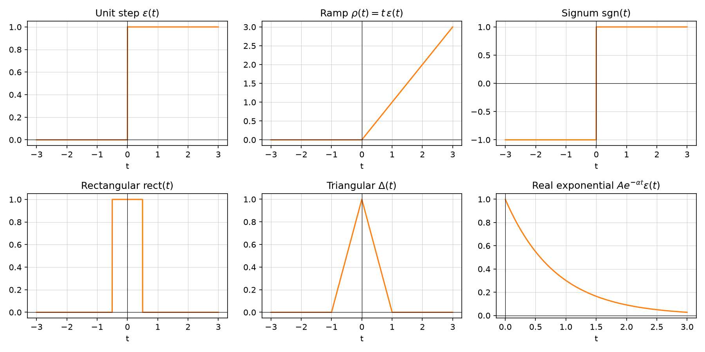
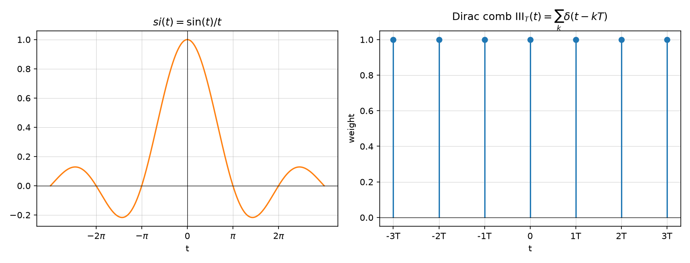

# Elementary signals

Source: [Lecture 1, pp. 3–4](../../raw/signals_1.pdf).

A small set of standard building-block signals recurs throughout the module.

## Unit step

$$\varepsilon(t) = \begin{cases} 0, & t < 0 \\ 1/2, & t = 0 \\ 1, & t > 0 \end{cases}$$

## Ramp

$$\rho(t) = t \cdot \varepsilon(t)$$

## Signum

$$\mathrm{sgn}(t) = \begin{cases} -1, & t < 0 \\ 0, & t = 0 \\ 1, & t > 0 \end{cases}$$

## Rectangular function

$$\mathrm{rect}(t) = \begin{cases} 0, & |t| > 1/2 \\ 1/2, & |t| = 1/2 \\ 1, & |t| < 1/2 \end{cases}$$

## Triangular function

$$\Delta(t) = \begin{cases} 0, & |t| > 1 \\ 1 - t, & 0 \le t \le 1 \\ 1 + t, & -1 \le t < 0 \end{cases}$$

## Real exponential

$$x(t) = A e^{\alpha t}$$

(causal version used in the exercises: $x(t) = A e^{-\alpha t}\varepsilon(t)$,
$\alpha > 0$, p. 3, p. 11).

## si-function (unnormalized sinc)

$$si(t) = \frac{\sin(t)}{t}$$

with $\displaystyle\int_{-\infty}^{\infty} si(t)\,dt = \int_{-\infty}^{\infty} si^2(t)\,dt = \pi$
(p. 4). Zero crossings occur at $t = n\pi$, $n \neq 0$.

*Figure: the six elementary signals above, plotted with illustrative parameter
values (rect width 1, triangle support [-1,1], $\alpha=1.2$). Generated by
[`elementary_signals.py`](../assets/plots/elementary_signals.py).*

*Figure: the si-function and a Dirac comb (see [Dirac impulse](dirac-impulse.md)).
Generated by [`sinc_and_dirac_comb.py`](../assets/plots/sinc_and_dirac_comb.py).*

## Related pages

- [Signal transformations](signal-transformations.md)
- [Dirac impulse](dirac-impulse.md)
- [Exercise 1 — Elementary and complex signals](../examples/exercise-1-elementary-and-complex-signals.md)
- [Lecture 1 summary](../summaries/signals-1.md)
