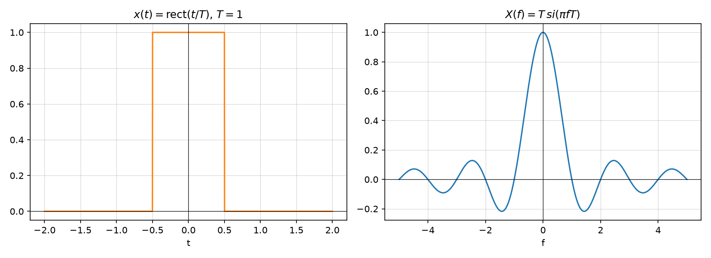

# Fourier transform pairs

Source: [Lecture 2, pp. 25–26, 29](../../raw/signals_2.pdf). A reference
table of standard transform pairs $x(t) \longleftrightarrow X(f)$, building on
[Elementary signals](elementary-signals.md) and [Dirac impulse](dirac-impulse.md).

| $x(t)$ | $X(f)$ |
|---|---|
| $\delta(t)$ | $1$ |
| $\delta(t-t_0)$ | $e^{-j2\pi f t_0}$ |
| $e^{j2\pi f_0 t}$ | $\delta(f-f_0)$ |
| $\cos(2\pi f_0 t)$ | $\tfrac12\big[\delta(f-f_0)+\delta(f+f_0)\big]$ |
| $\sin(2\pi f_0 t)$ | $\tfrac{1}{2j}\big[\delta(f-f_0)-\delta(f+f_0)\big]$ |
| $\mathrm{III}_T(t)=\sum_k \delta(t-kT)$ | $\tfrac{1}{T}\sum_k \delta\big(f-\tfrac{k}{T}\big)$ |
| $\varepsilon(t)$ | $\tfrac12\delta(f) + \tfrac{1}{j2\pi f}$ |
| $\mathrm{sgn}(t)$ | $\tfrac{1}{j\pi f}$ |
| $\mathrm{rect}(t/T)$ | $T\,si(\pi f T)$ |
| $si(\pi t/T)$ | $T\cdot\mathrm{rect}(fT)$ (value $T$ for $\lvert f\rvert<\tfrac{1}{2T}$, $T/2$ at $\lvert f\rvert=\tfrac{1}{2T}$, else 0) |
| $\Lambda(t)$ (triangle, support $[-1,1]$) | $si^2(\pi f)$ |

(p. 25, p. 26, p. 29).

*Figure: `rect`–`si` pair for $T=1$. Generated by
[`lecture2_plots.py`](../assets/plots/lecture2_plots.py).*

*Figure: $\Lambda(t)$–$si^2(\pi f)$ pair. Generated by
[`lecture2_plots.py`](../assets/plots/lecture2_plots.py).*

The `rect`–`si` and `si`–`rect` pairs are a direct consequence of the
**duality** property (p. 30); see
[Exercise — Fourier transform of rect, triangle, and periodic signals](../examples/exercise-fourier-transform-rect-triangle-and-periodic-signals.md)
for the derivation.

## Related pages

- [Fourier transform](fourier-transform.md)
- [Fourier transform properties](fourier-transform-properties.md)
- [Elementary signals](elementary-signals.md)
- [Dirac impulse](dirac-impulse.md)
