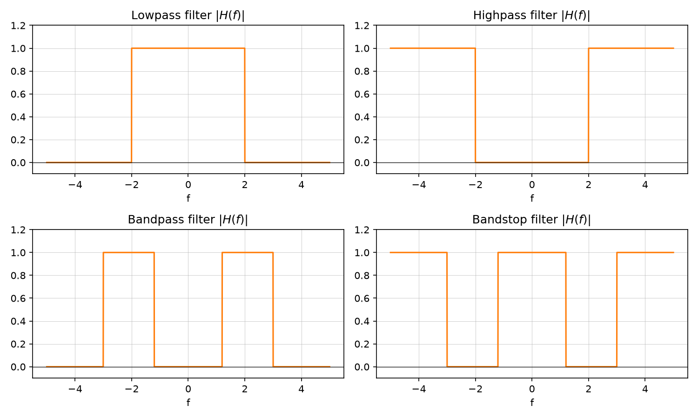

# LTI system frequency response and filter types

Source: [Lecture 3, pp. 1–3](../../raw/signals_3.pdf). Builds on
[LTI systems](lti-systems.md) and [Fourier transform](fourier-transform.md).

## Magnitude and phase response

$$y(t) = h(t)*x(t) \;\Longleftrightarrow\; Y(f) = H(f)\,X(f), \qquad
H(f) = |H(f)|\,e^{j\varphi(f)}$$

$$|H(f)| = \sqrt{\mathrm{Re}\{H(f)\}^2 + \mathrm{Im}\{H(f)\}^2}, \qquad
\varphi(f) = \arg\{H(f)\} = \arctan\!\left(\frac{\mathrm{Im}\{H(f)\}}{\mathrm{Re}\{H(f)\}}\right)$$

For a real-valued impulse response, the magnitude response is **even** and
the phase response is **odd**: $|H(f)| = |H(-f)|$, $\varphi(f) = -\varphi(-f)$
(p. 1). For the output of an LTI system driven by $x(t)$:

$$|Y(f)| = |H(f)|\,|X(f)|, \qquad \varphi_y(f) = \arg\{H(f)\} + \arg\{X(f)\}$$

## Transmission factor, attenuation, gain

$$g(f) = -\ln H(f) = a(f) - j\,b(f)$$

$$\text{Attenuation (dB): } a(f) = -20\log_{10}|H(f)|\ \mathrm{dB} = -10\log_{10}|H(f)|^2\ \mathrm{dB}$$

$$\text{Gain (dB): } -a(f)$$

(p. 2).

## Frequency-flat vs. frequency-selective systems

A **frequency-flat** system has constant $|H(f)|$ (e.g. a pure gain
$h(t) = h_0\delta(t)$); a **frequency-selective** system has $|H(f)|$ that
varies with frequency (e.g. a multi-tap impulse response) (p. 2).

## Basic filter types

| Filter | Passband | Stopband |
|---|---|---|
| Lowpass | $\lvert f\rvert < f_c$ | $\lvert f\rvert > f_c$ |
| Highpass | $\lvert f\rvert > f_c$ | $\lvert f\rvert < f_c$ |
| Bandpass | $f_l < \lvert f\rvert < f_u$ | elsewhere |
| Bandstop | elsewhere | $f_l < \lvert f\rvert < f_u$ |

with $f_c$ the cutoff frequency, $f_l$/$f_u$ the lower/upper cutoff
frequencies of the passband or stopband (p. 3).

*Figure: schematic (brick-wall) magnitude responses. Generated by
[`lecture3_plots.py`](../assets/plots/lecture3_plots.py).*

## Related pages

- [LTI systems](lti-systems.md)
- [Phase and group delay](phase-and-group-delay.md)
- [LTI systems in the s-domain](lti-systems-s-domain.md)
- [Exercise — Multicarrier transmission](../examples/exercise-multicarrier-transmission.md)
