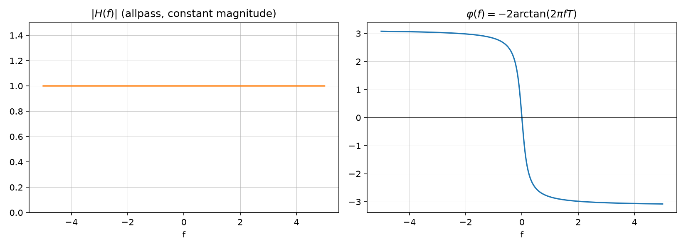

# Phase delay, group delay, and distortion-free systems

Source: [Lecture 3, pp. 4–5](../../raw/signals_3.pdf). Builds on
[LTI system frequency response and filter types](lti-frequency-response.md).

## Phase delay and group delay

For an LTI system with input $x(t) = e^{j2\pi f_0 t}$, frequency response
$H(f)$, the output is $y(t) = |H(f_0)|\,e^{j(2\pi f_0 t + \varphi(f_0))}$ (p. 4).

$$\textbf{Phase delay: } t_p(f) = \frac{-\varphi(f)}{2\pi f} = \frac{b(f)}{2\pi f}$$

The phase delay is the delay the system causes to an oscillation at frequency
$f_0$. Problem: **different frequencies generally have different phase
delays** (p. 4).

$$\textbf{Group delay: } t_g(f) = \frac{-1}{2\pi}\frac{d}{df}\varphi(f) = \frac{1}{2\pi}\frac{d}{df}b(f)$$

The group delay is the delay the system causes to the *envelope* of a
narrowband signal; the delay to an oscillation at the carrier frequency $f_0$
is given by the phase delay (p. 4).

## Linear phase systems

A system has **linear phase** if it has a constant group delay, i.e. all
frequency components of an input signal are delayed by the same amount
(p. 4): group delay ≈ delay of the signal envelope, phase delay ≈ delay of
the carrier oscillation.

## Distortion-free systems

A **distortion-free** system causes only a delay and amplitude scaling of the
input signal:

$$h(t) = a\,\delta(t-t_0) \;\longleftrightarrow\; H(f) = a\,e^{-j2\pi f t_0}$$

Its magnitude response is constant ($|H(f)|=a$), its phase is linear
($\varphi(f) = -2\pi f t_0$), and its group delay is constant,
$t_g(f) = t_0$ (p. 5).

## Worked example: an allpass filter

For $H(f) = \dfrac{1-j2\pi f T}{1+j2\pi f T}$:

$$|H(f)| = 1 \ \text{(constant magnitude, an allpass filter)}$$

$$\varphi(f) = -2\arctan(2\pi f T)$$

$$t_p(f) = \frac{\arctan(2\pi f T)}{\pi f}, \qquad
t_g(f) = \frac{2T}{1+4\pi^2 f^2 T^2}$$

(pp. 6–7). See
[Exercise — Group and phase delay of an allpass filter](../examples/exercise-group-and-phase-delay-allpass-filter.md)
for the full derivation.

*Figure: generated by [`lecture3_plots.py`](../assets/plots/lecture3_plots.py).*

## Related pages

- [LTI system frequency response and filter types](lti-frequency-response.md)
- [LTI systems in the s-domain](lti-systems-s-domain.md) (allpass/minimum-phase filters)
- [Exercise — Group and phase delay of an allpass filter](../examples/exercise-group-and-phase-delay-allpass-filter.md)
