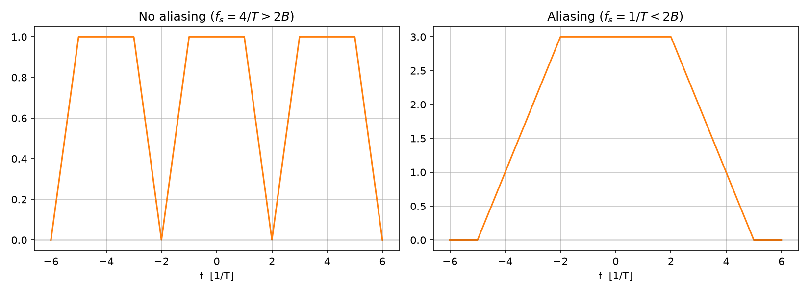

# Sampling and reconstruction

Source: [Lecture 4, pp. 1–4](../../raw/signals_4.pdf). Sampling converts a
continuous-time signal into regularly spaced values. The notes connect exact
reconstruction to a band-limited spectrum and an ideal low-pass reconstruction
filter.

## Impulse-train model

For sampling period $T_s$ and sampling frequency $f_s=1/T_s$, the sampled
signal is represented by

$$x_s(t)=x(t)\sum_{n=-\infty}^{\infty}\delta(t-nT_s)
=\sum_{n=-\infty}^{\infty}x(nT_s)\delta(t-nT_s).$$

If $X(f)$ is the Fourier transform of $x(t)$, the sampled spectrum consists of
frequency-shifted copies of $X(f)$, spaced by $f_s$:

$$X_s(f)=f_s\sum_{n=-\infty}^{\infty}X(f-nf_s).$$

This replication in frequency is the reason that sampling rate affects
reconstruction (pp. 1–3).

*Figure: periodic repetition of a trapezoidal base spectrum at spacing $f_s$.
Left: $f_s$ large enough that replicas do not overlap. Right: $f_s$ too
small, replicas overlap (aliasing). Generated by
[`lecture4_plots.py`](../assets/plots/lecture4_plots.py).*

## Band-limited reconstruction condition

For a signal whose spectrum is confined to $|f|\le B$, the notes state that
perfect reconstruction is possible when

$$f_s\ge 2B.$$

Under this condition the spectral copies do not overlap, and an ideal low-pass
filter can recover the original analog signal. This is the sampling condition
as stated in the notes; they do not discuss practical non-ideal filters or
what happens at a particular boundary-frequency convention (pp. 1, 3–4).

## Related pages

- [Signal classification](signal-classification.md)
- [Fourier transform](fourier-transform.md)
- [Discrete-time Fourier transform](discrete-time-fourier-transform.md)
- [Lecture 4 summary](../summaries/signals-4.md)
