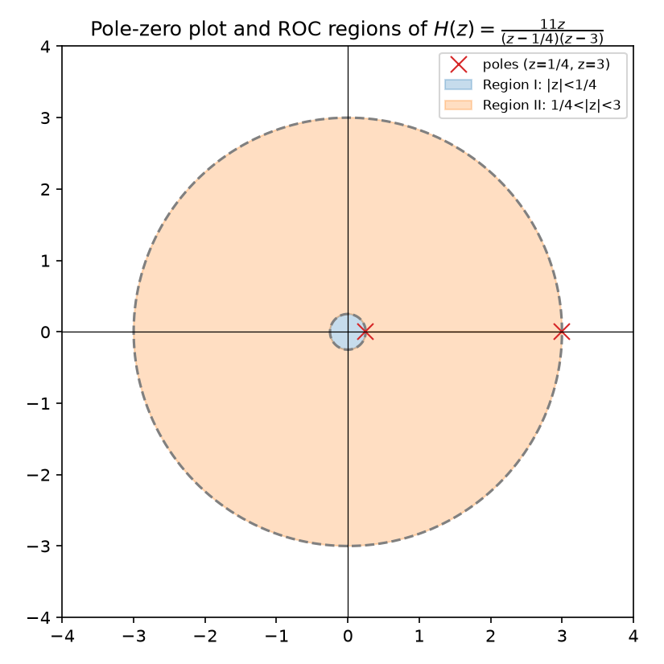

# Z-transform

Source: [Lecture 4, pp. 24–30](../../raw/signals_4.pdf). The bilateral
Z-transform represents a discrete-time sequence with a complex variable $z$.
The transform expression and its region of convergence (ROC) together
identify the sequence.

## Definition and relation to other transforms

$$X(z)=\sum_{k=-\infty}^{\infty}x[k]z^{-k}.$$

The notes relate it to the bilateral Laplace transform using
$z=e^{sT_s}$. On the unit circle, $z=e^{j\Omega}$, so the Z-transform
expression becomes the DTFT sum, when the ROC includes that circle (pp. 24,
26). The Z-transform ROC is generally a circular annulus; the Laplace ROC is
a vertical strip (p. 24).

## Region of convergence

The ROC is the set of $z$ values for which the defining series converges.
For the causal geometric sequence

$$x[k]=a^k\varepsilon[k],\qquad
X(z)=\frac{z}{z-a},\qquad |z|>|a|.$$

For the anti-causal sequence

$$x[k]=-a^k\varepsilon[-k-1],\qquad
X(z)=\frac{z}{z-a},\qquad |z|<|a|.$$

The algebraic expression $z/(z-a)$ is the same, but the ROC distinguishes
the two sequences (pp. 25, 29). For a causal sequence, the ROC lies outside
a circle; for an anti-causal sequence, it lies inside a circle. A two-sided
sequence can have an annular ROC between pole magnitudes (p. 26).

*Figure: ROC regions for $H(z)=\dfrac{11z}{(z-1/4)(z-3)}$ (a worked example
on pp. 29–30 of the source); Region III, $|z|>3$, extends outward and is not
shaded. Generated by [`lecture4_plots.py`](../assets/plots/lecture4_plots.py).*

## Poles and stability

For a rational Z-transform, poles are excluded from the ROC. The notes state
that a system is BIBO stable if its transfer-function ROC includes the unit
circle (p. 25). For causal systems, the ROC extends outward from the
outermost pole; causality and stability therefore require all poles to lie
inside the unit circle (pp. 25, 29).

## Properties listed in the notes

If $x[k]\longleftrightarrow X(z)$, the recorded properties include

| Sequence operation | Z-transform |
|---|---|
| $x[k-k_0]$ | $z^{-k_0}X(z)$ |
| $x[k]*y[k]$ | $X(z)Y(z)$ |
| $\alpha x[k]+\beta y[k]$ | $\alpha X(z)+\beta Y(z)$ |
| $k\,x[k]$ | $-z\dfrac{dX(z)}{dz}$ |

(p. 26). From the defining sum, multiplying $x[k]$ by $e^{\alpha kT_s}$
gives $X(e^{-\alpha T_s}z)$. The exponential-scaling entry on p. 26 appears
to show the opposite sign in its argument; it is not copied as a source-backed
property because it conflicts with the stated transform definition.

## Related pages

- [Discrete-time Fourier transform](discrete-time-fourier-transform.md)
- [Laplace transform](laplace-transform.md)
- [LTI systems in the s-domain](lti-systems-s-domain.md)
- [Digital filters](digital-filters.md)
- [Lecture 4 summary](../summaries/signals-4.md)
- [Lecture 5 summary](../summaries/signals-5.md)
