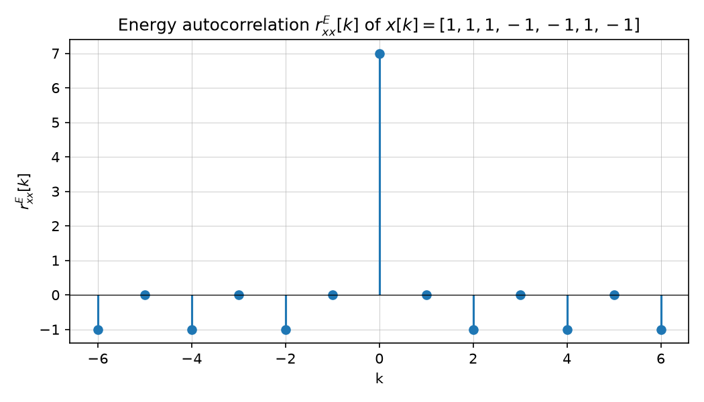

# Exercise 2 — Orthogonality and correlation

Source: [Lecture 1, Exercise 2, pp. 16–27](../../raw/signals_1.pdf). Builds on
[Correlation and orthogonality](../concepts/correlation-and-orthogonality.md).

## a) Orthogonality of complex exponentials

Show $s_1(t) = e^{j2\pi k f_0 t}$ and $s_2(t) = e^{j2\pi \ell f_0 t}$,
$k,\ell \in \mathbb{Z}$, $k \neq \ell$, are orthogonal on $[0, 1/f_0]$:

$$\langle s_1, s_2\rangle = \int_0^{1/f_0} \cos\big(2\pi(k+\ell)f_0 t\big) + j\sin\big(2\pi(k-\ell)f_0 t\big)\,dt = 0$$

since both the cosine and sine terms integrate to zero over a full number of
periods whenever $k \neq \ell$ (p. 16). Hence the signals are orthogonal.

## b) Autocorrelation of $x[k] = [1,1,1,-1,-1,1,-1]$

$$r_{xx}^{E}[k] = \begin{cases} 7, & k=0 \\ -1, & |k|\in\{2,4,6\} \\ 0, & \text{otherwise} \end{cases}$$

(p. 16–17, also see the figure above on
[Correlation and orthogonality](../concepts/correlation-and-orthogonality.md)).

## c) Autocorrelation of a periodic sequence (period 2: `1,1,1,1,1,1,1,1`-style alternation)

For a periodic sequence of 1's, the autocorrelation $r_{xx}^{E}[k]$ grows
roughly linearly/triangularly, giving

$$r_{xx}^{E}[k] = \begin{cases} 7-|k|, & |k| \in [0,7] \\ 0, & \text{otherwise} \end{cases}$$

The notes add a practical remark: for applications like radar or
synchronization, the autocorrelation sidelobes ($k \neq 0$) should be close to
zero so there is one sharp, easily detectable peak — this is why Barker codes
(which have much better sidelobe properties) are preferred in practice (p. 18).

## d) Cross-correlation of two length-4 sequences

For $y[k] = [1,-1,1,-1]$ and $x[k] = [1,1,-1,-1]$:

$$r_{xy}^{E}[k] = \begin{cases} 1, & k \in \{1,-1\} \\ -1, & k \in \{3,-3\} \\ 0, & \text{otherwise} \end{cases}$$

(p. 19).

## e) Orthogonality of periodic sequences

For periodic sequences $g[k]$ and $\tilde z[k]$ built from alternating
$\pm 1$ patterns, the (power) cross-correlation evaluates to

$$r_{\tilde g \tilde z}^{P}[k] = \frac{1}{N}\sum_{k=0}^{N-1} x^*[k]\,y[k+k'] = 0 \quad\Rightarrow\quad \tilde g[k] \perp \tilde z[k]$$

i.e. the two periodic sequences are orthogonal (p. 20).

## f) Continuous cross-correlation of a ramp-like pulse and a half-rect pulse

For $x(t) = \dfrac{t}{T}$ on $0 \le t < T$ (zero elsewhere) and
$y(t) = \tfrac12\,\mathrm{rect}\!\left(\dfrac{t-T/2}{T}\right)$:

$$r_{xy}^{E}(\tau) = \begin{cases}
0, & |\tau| > T \\
\dfrac{T^2-\tau^2}{4T}, & -T<\tau<0 \\
T/4, & \tau = 0 \\
\dfrac{(\tau+T)^2}{4T}, & 0<\tau<T
\end{cases}$$

(p. 21–22), with sample values $r_{xy}^{E}(-T/2) = 3T/16$ and
$r_{xy}^{E}(T/2) = T/4$ (p. 23).

## g) Properties check: $r_{xx}(\tau) = r_{xx}^*(-\tau)$

Verified by substitution $t' = t - \tau$ in the defining integral (p. 24),
confirming the conjugate-even property stated in
[Correlation and orthogonality](../concepts/correlation-and-orthogonality.md).

## h) Autocorrelation of the ramp-like pulse $x(t) = t/T$ on $[0,T)$

$$r_{xx}^{E}(\tau) = \begin{cases}
0, & |\tau|>T \\
\dfrac{2T^3+3\tau T^2-\tau^3}{6T^2}, & -T \le \tau < 0 \\
T/3, & \tau = 0 \\
\dfrac{2(T-\tau)^3+3\tau(T-\tau)^2}{6T^2}, & 0<\tau\le T
\end{cases}$$

with $E_x = r_{xx}^{E}(0) = T/3$ (p. 25–27), consistent with
$r_{xx}(0) \ge |r_{xx}(\tau)|$ from
[Correlation and orthogonality](../concepts/correlation-and-orthogonality.md).

## Related pages

- [Correlation and orthogonality](../concepts/correlation-and-orthogonality.md)
- [Lecture 1 summary](../summaries/signals-1.md)
