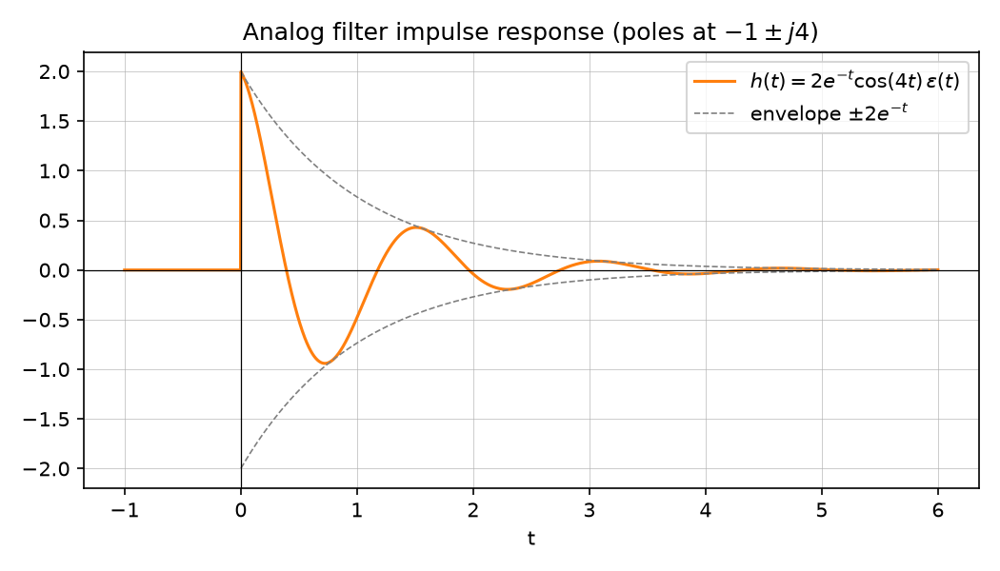

# Exercise — Analog filter design

Source: [Lecture 3, pp. 28–32](../../raw/signals_3.pdf). Builds on
[LTI systems in the s-domain](../concepts/lti-systems-s-domain.md).

## Setup

$$H(s) = \frac{2(s+1)}{s^2+2s+17}$$

## a) Pole-zero plot

Factor the denominator: $s_{1,2} = -1 \pm \sqrt{1-17} = -1\pm j4$, so

$$H(s) = \frac{2(s+1)}{\big(s-(-1+j4)\big)\big(s-(-1-j4)\big)}$$

One zero at $s=-1$; two complex-conjugate poles at $s=-1\pm j4$ (p. 28).

## b) Convergence region and causality

A causal system has a convergence region that is a right half-plane; this
system's poles are at $\mathrm{Re}\{s\}=-1$, so the ROC for the causal
system is $\mathrm{Re}\{s\}>-1$ (p. 28).

## c) Stability

Both poles lie in the **left half-plane** ($\mathrm{Re}\{s\}=-1<0$), so the
system is **stable** (p. 28), per
[LTI systems in the s-domain](../concepts/lti-systems-s-domain.md).

## d) Magnitude-squared frequency response

$$|H(f)|^2 = \left|\frac{2(j2\pi f+1)}{(j2\pi f)^2 - 2(j2\pi f)\cdot 1\cdot ... }\right|^2
= \frac{4\big(4\pi^2f^2+1\big)}{(2\pi f)^4 - 30(2\pi f)^2 + 289}$$

(p. 29, derived by substituting $s=j2\pi f$ and expanding).

## e) Limiting values and sketch

$$|H(f=0)|^2 = \frac{4}{289}, \qquad |H(f\to\infty)|^2 \to 0$$

(p. 29). The notes sketch $|H(f)|^2$ as a resonance-like curve peaking near
$f_0 = \dfrac{2}{\pi}$ (the imaginary part of the poles corresponds to a
resonant frequency $\omega_0=4\;\mathrm{rad/s} \Rightarrow f_0 = \omega_0/2\pi = 2/\pi$, p. 30).

## f)–g) Partial-fraction decomposition and impulse response

$$H(s) = \frac{2(s+1)}{(s-(-1+j4))(s-(-1-j4))} = \frac{A}{s-(-1+j4)} + \frac{B}{s-(-1-j4)}$$

Solving by substitution at $s=-1+j4$ and $s=-1-j4$ gives $A=B=1$ (p. 31):

$$H(s) = \frac{1}{s-(-1+j4)} + \frac{1}{s-(-1-j4)}$$

## h)–i) Inverse Laplace transform and sketch

$$h(t) = e^{(-1+j4)t}\varepsilon(t) + e^{(-1-j4)t}\varepsilon(t)
= e^{-t}\varepsilon(t)\big(e^{j4t}+e^{-j4t}\big) = 2e^{-t}\cos(4t)\,\varepsilon(t)$$

(p. 32) — a causal, exponentially decaying (stable) damped oscillation at
angular frequency 4 rad/s.

*Figure: $h(t) = 2e^{-t}\cos(4t)\,\varepsilon(t)$, confirming the pole
locations at $-1\pm j4$ via the decay rate (real part) and oscillation
frequency (imaginary part). Generated by
[`lecture3_plots.py`](../assets/plots/lecture3_plots.py).*

## Related pages

- [LTI systems in the s-domain](../concepts/lti-systems-s-domain.md)
- [Laplace transform](../concepts/laplace-transform.md)
