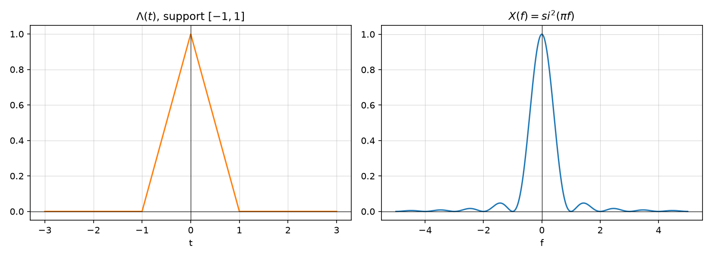
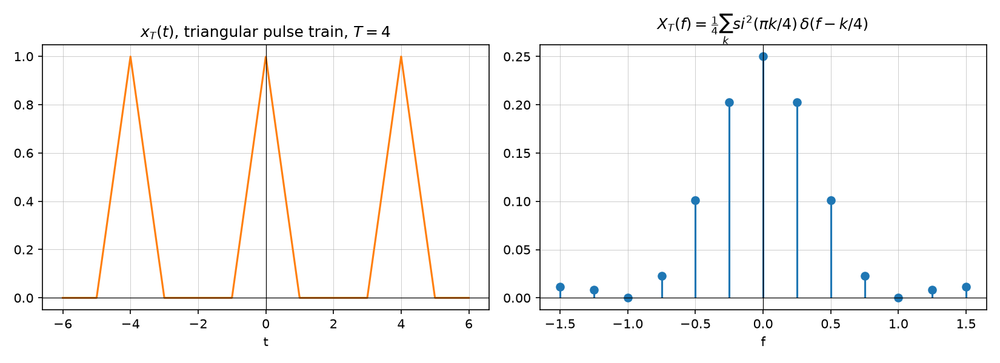

# Exercise — Fourier transform of rect, triangle, and periodic signals

Source: [Lecture 2, pp. 30–36](../../raw/signals_2.pdf). Builds on
[Fourier transform](../concepts/fourier-transform.md),
[Fourier transform properties](../concepts/fourier-transform-properties.md),
and [Fourier transform pairs](../concepts/fourier-transform-pairs.md).

## a) Duality: $\mathrm{rect}(t/T) \leftrightarrow |T|\,si(\pi f T)$

Starting from the base pair $\mathrm{rect}(t) \leftrightarrow si(\pi f)$ and
applying the scaling property $x(at) \leftrightarrow \tfrac{1}{|a|}X(f/a)$
with $a = 1/T$:

$$\mathrm{rect}(t/T) \longleftrightarrow |T|\,si(\pi f T)$$

(p. 30).

## b) Fourier transform of $x(t) = |F|\,si(\pi F t)$

By duality on the same base pair ($X(t) \leftrightarrow x(-f)$, and `rect` is
even so the sign flip is immaterial):

$$|F|\,si(\pi F t) \longleftrightarrow \mathrm{rect}(f/F)$$

(p. 30).

## c) Inverse Fourier transform of a triangular spectrum $X(f) = \Lambda\!\left(\frac{f-f_0}{B}\right)$, $B>0$

Using the base pair $si^2(\pi t) \leftrightarrow \Lambda(f)$ together with the
scaling and modulation properties:

$$|B|\,si^2(\pi B t)\,e^{j2\pi f_0 t} \longleftrightarrow \Lambda\!\left(\frac{f-f_0}{B}\right), \qquad B>0$$

(p. 31).

## d)–e) Fourier transform of the triangular pulse $\Lambda(t)$ (support $[-1,1]$)

$$\Lambda(t) = \begin{cases} 0, & |t|>1 \\ 1-t, & 0\le t\le 1 \\ 1+t, & -1\le t<0 \end{cases}$$

Direct integration $X(f) = \int_{-1}^{0}(1+t)e^{-j2\pi ft}dt + \int_0^1 (1-t)e^{-j2\pi ft}dt$,
carried out term-by-term with integration by parts (pp. 32–33), yields

$$X(f) = \frac{2\sin^2(\pi f)}{\pi^2 f^2} = si^2(\pi f)$$

matching the [Fourier transform pairs](../concepts/fourier-transform-pairs.md)
table.

*Figure: generated by [`lecture2_plots.py`](../assets/plots/lecture2_plots.py).*

## Fourier transform of a periodic triangular pulse train (period $T=4$)

Let $x_T(t)$ be the periodic repetition of $\Lambda(t)$ with period $T=4$
(p. 34).

**c)** Sketch: a train of triangular pulses of half-width 1, spaced 4 apart.

**d)** Represent as a convolution with a Dirac comb:

$$x_T(t) = \Lambda(t) * \sum_{k=-\infty}^{\infty}\delta(t-4k)$$

(p. 34), per [Convolution](../concepts/convolution.md).

**e)** Using $\Lambda(t) \leftrightarrow si^2(\pi f)$ and the convolution-with-comb
property, the spectrum is a sampled version of the $si^2$ envelope at spacing
$1/T = 1/4$:

$$X_T(f) = \frac{si^2(\pi f)}{4}\sum_{k=-\infty}^{\infty}\delta\!\left(f-\frac{k}{4}\right)
= \frac{1}{4}\sum_{k=-\infty}^{\infty} si^2\!\left(\frac{\pi k}{4}\right)\delta\!\left(f-\frac{k}{4}\right)$$

(p. 34–35).

*Figure: generated by [`lecture2_plots.py`](../assets/plots/lecture2_plots.py).
Stem heights match $si^2(\pi k/4)/4$ evaluated at each harmonic $k/4$.*

**f)** Identifying the relation between the Fourier transform $X(f)$ of a
single period and the complex Fourier series coefficients $X_n$ of the
periodic signal (p. 35, and confirmed generally in
[Fourier series](../concepts/fourier-series.md)):

$$X_n = \frac{1}{T}\,X\!\left(\frac{n}{T}\right) = \frac14\,si^2\!\left(\frac{\pi n}{4}\right)$$

## Related pages

- [Fourier transform](../concepts/fourier-transform.md)
- [Fourier transform pairs](../concepts/fourier-transform-pairs.md)
- [Fourier series](../concepts/fourier-series.md)
- [Convolution](../concepts/convolution.md)
